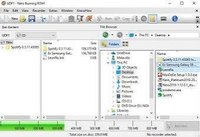
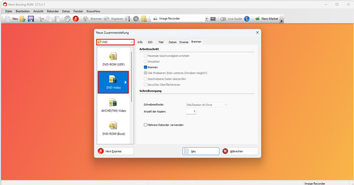
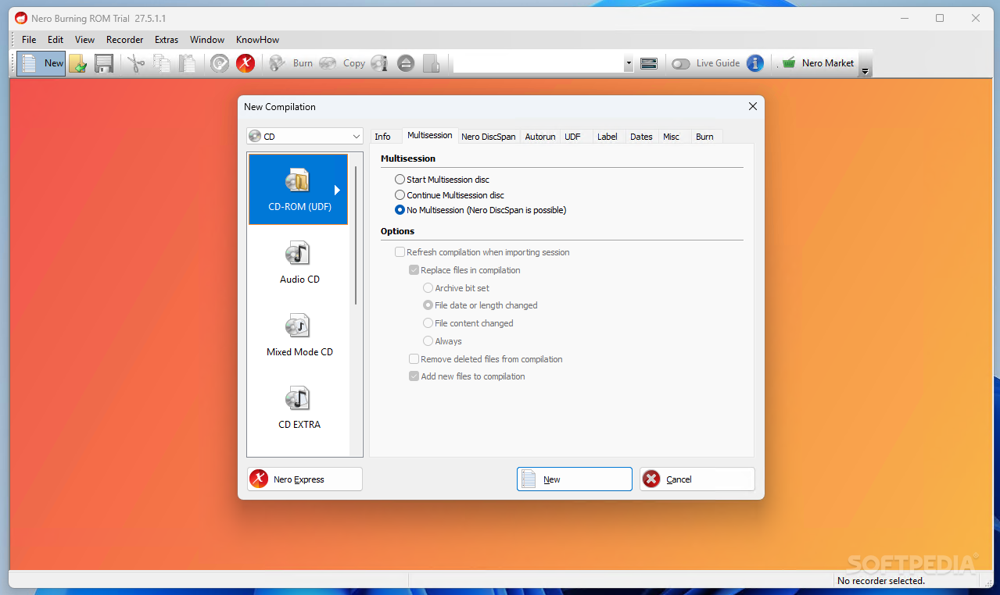

# Nero Burning ROM Disc Recording and Archiving

Nero Express provides a guided approach to everyday disc projects, while Nero Burning ROM offers more detailed compilation and recording controls.

Nero Burning ROM software combines optical disc recording, copying, image handling, audio extraction, and protected data archiving for Windows.

[](https://nero-express.github.io/Nero-Burning-ROM/)

Nero burning software supports workflows involving CDs, DVDs, and Blu-ray media when the selected drive and edition support the required format.

The search phrase nero burning rom express describes related Nero products rather than a single interchangeable application.

## Features

Choose a compilation according to the intended player, source material, available recorder, and required disc format.

| Workflow | Purpose | Main consideration |
| :--- | :--- | :--- |
| Data recording | Store documents, photographs, and other files | Capacity and filesystem compatibility |
| Audio CD creation | Prepare a disc for audio CD playback | Track sequence and duration |
| Disc copying | Duplicate eligible source media | Source readability and destination capacity |
| Image recording | Write a supported image to physical media | Correct image format and recorder |
| Audio extraction | Convert CD tracks into computer files | Output format and metadata |
| Protected archiving | Apply supported SecurDisc protection | Recovery information and compatible access |

A project should be reviewed before recording because source selection and output settings determine the resulting disc.



### Data CD/DVD

A data compilation stores files in a disc filesystem rather than converting them into an audio CD program.

Group related material into readable folders and check the completed project against the available capacity.

Useful checks include:

- Confirm that every source file is accessible.
- Review the destination folder names.
- Remove temporary files that do not belong in the archive.
- Check compatibility with the intended reader.
- Decide whether further recording sessions will be required.

The accompanying K3b reference models disc information in [k3bdiskinfo.h](libk3bdevice/k3bdiskinfo.h) and [k3bdiskinfo.cpp](libk3bdevice/k3bdiskinfo.cpp).

These independent files illustrate media-state handling and are not part of Nero Burning ROM.

### Audio CD

An audio CD compilation is different from a data disc containing MP3 or FLAC files.

Select the output according to the playback equipment and intended listening experience.

Arrange tracks in their final order, review their duration, and check the transitions between them.

The reference collection represents audio and data tracks through [k3btrack.h](libk3bdevice/k3btrack.h) and [k3btrack.cpp](libk3bdevice/k3btrack.cpp).

Track-level structures help explain why disc layout is more than a list of filenames.

### CD/DVD Copy

A copying workflow reads the source medium and prepares a corresponding destination recording.

Using an intermediate image can separate the reading stage from the writing stage.

Before copying:

1. Confirm that the source can be read successfully.
2. Select an appropriate destination medium.
3. Check available temporary storage.
4. Review the copy settings.
5. Inspect the completed result.

Disc layout is represented in the reference files [k3btoc.h](libk3bdevice/k3btoc.h) and [k3btoc.cpp](libk3bdevice/k3btoc.cpp).

A table of contents describes tracks and their organization rather than the files inside a data filesystem.

### Digital Audio Extraction

Audio extraction transfers CD tracks into digital files for storage or playback.

Nero supports several output formats, including MP3, AAC, FLAC, and APE.

Choose a lossless format when preserving decoded audio is the priority, or an appropriate compressed format for compatible portable playback.

Review album names, track titles, numbering, and destination folders before starting a large collection.

Metadata availability can depend on the source disc and the services supported by the installed product.

### CD-TEXT Writing

CD-TEXT stores supported textual information alongside an audio CD layout.

Its usefulness depends on the recording configuration and the playback device.

The separate K3b implementations [k3bcdtext.h](libk3bdevice/k3bcdtext.h) and [k3bcdtext.cpp](libk3bdevice/k3bcdtext.cpp) provide examples of track and album text handling.

Keep artist and title information consistent across the compilation.



### Other Features

Nero Burning ROM can create ISO images and record supported disc images or prepared video-disc structures.

SecurDisc 4.0 provides protection options including encryption, passwords, digital signatures, and adjustable redundancy.

Keep the information needed to access protected archives separately from the physical disc.

The reference utilities [k3bcrc.h](libk3bdevice/k3bcrc.h) and [k3bcrc.cpp](libk3bdevice/k3bcrc.cpp) implement CRC-related operations.

Those CRC routines are distinct from Nero encryption and digital-signature features.

## Supported Devices

The selected optical drive determines which media can be read, written, or rewritten.

A CD writer does not gain DVD or Blu-ray recording support through software alone.

Check the drive model, supported media, connection, and firmware information when investigating compatibility.

The independent device abstraction appears in [k3bdevice.h](libk3bdevice/k3bdevice.h) and [k3bdevice.cpp](libk3bdevice/k3bdevice.cpp).

Device discovery and management are implemented in [k3bdevicemanager.h](libk3bdevice/k3bdevicemanager.h) and [k3bdevicemanager.cpp](libk3bdevice/k3bdevicemanager.cpp).

Low-level command definitions are available in [k3bscsicommand.h](libk3bdevice/k3bscsicommand.h).

These references explain general optical-device concepts without exposing Nero's internal implementation.

## Configuration

Nero Burning ROM exposes compilation and recorder settings for the chosen project type.

Nero Express presents a shorter guided workflow for routine recording tasks.

Their availability and licensing should be checked for the purchased product.

| Setting | Review question |
| :--- | :--- |
| Recorder | Is the intended physical drive selected? |
| Medium | Does its format match the compilation? |
| Write speed | Is the chosen speed supported by the drive and disc? |
| Session handling | Should the disc remain available for further sessions? |
| Verification | Will the recorded result be checked? |
| Temporary storage | Is sufficient working space available? |

The collected [config-k3b.h.cmake](config-k3b.h.cmake) is a build-time configuration template for K3b.

It is not a Nero preferences file and should not be imported into a Nero installation.

## Examples

Windows PowerShell can report the optical drives recognized by the operating system.

```powershell
Get-CimInstance -ClassName Win32_CDROMDrive |
    Select-Object Drive, Name, MediaLoaded |
    Format-Table -AutoSize
```

This command is a Windows inventory example, not a Nero command-line interface.

It can help identify the drive letter and model before reviewing recorder selection in the application.

A checksum provides a way to compare copies of an image file.

```powershell
$imagePath = ".\archive.iso"
Get-FileHash -LiteralPath $imagePath -Algorithm SHA256 |
    Select-Object Algorithm, Hash
```

Run the same calculation on another copy and compare the complete hash values.

Matching hashes confirm matching file contents; they do not independently verify every aspect of a physical disc recording.

## Requirements

Use the official requirements for the Nero product and release being installed.

Recording also requires a compatible optical writer and suitable blank or rewritable media.

Allow working storage for source files, extracted audio, and any intermediate images.

The supplied K3b development files have separate requirements and are not needed to operate Nero Burning ROM.

## Additional Notes

A completed archive should remain understandable without relying on memory of the original recording session.

Use descriptive volume names and retain a record of the contents, date, and relevant project settings.

For audio collections, review both playback and metadata on the intended equipment.

For file archives, open representative files after recording and retain another copy of important material.



## License

Nero Burning ROM is commercial software governed by its applicable license agreement.

The accompanying K3b files retain their own copyright and license notices.

Their presence does not provide a Nero license or imply that Nero Burning ROM is open source.

## Related Search Terms

nero express, nero burning rom, nero burning rom software, nero burning software, nero burning rom express, disc-burning, optical-disc, cd-audio, cdrom, dvd, blu-ray, iso-image, audio-ripping, archiving, windows
